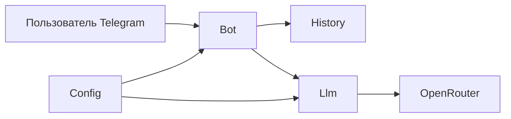

# Техническое видение

Документ описывает техническое видение LLM-ассистента в виде Telegram-бота. Исходная идея — в [idea.md](idea.md). Это отправная точка и технический проект для разработки.

## 1. Технологии

- **Python 3.15** — язык реализации.
- **uv** — окружение и зависимости. Описание проекта в `pyproject.toml`, зафиксированные версии в `uv.lock`. Установка через `uv sync`.
- **openai** — клиент к LLM. Запросы идут к OpenRouter через совместимый с OpenAI endpoint.
- **python-dotenv** — чтение настроек из файла `.env`.
- **aiogram 3** — Telegram Bot API, обновления методом polling.
- **Docker** — локальный запуск в контейнере.
- **make** — сборка и запуск: локально через uv и через Docker.

На этом этапе в стеке нет базы данных, очередей, веб-фреймворка, тестов и линтеров. История диалога живёт в памяти процесса.

## 2. Принцип разработки

- **KISS.** Самый короткий путь проверки идеи: сообщение в Telegram, ответ модели, ответ пользователю.
- **Один класс — один файл.** У класса нет других классов в том же файле. Функции без состояния допустимы в модуле, если для них не нужен класс.
- **Прямые вызовы.** Объекты создаются в точке использования. Без контейнера зависимостей, базовых классов «на будущее» и слоёв с одним потребителем.
- **Только нужное поведение.** Роль из системного промпта, диалог в Telegram, история чата в памяти процесса и ответ модели. Всё, что не проверяет идею, в первую версию не входит.
- **Автотесты и линтеры в эту версию не входят.** Аннотации типов пишем в сигнатурах, без отдельного прогона проверки типов.

## 3. Структура проекта

```
.
├── docs/
│   ├── idea.md
│   └── vision.md
├── src/
│   └── assistant/
│       ├── __init__.py
│       ├── main.py
│       ├── config.py
│       ├── history.py
│       ├── llm.py
│       └── bot.py
├── pyproject.toml
├── uv.lock
├── Makefile
├── Dockerfile
├── .env.example
└── .gitignore
```

- `main.py` — функция `main`: собирает объекты и запускает polling.
- `config.py` — класс `Config`: токен бота, ключ OpenRouter, имя модели, текст роли.
- `history.py` — класс `History`: реплики чата в памяти процесса.
- `llm.py` — класс `Llm`: роль, история и новое сообщение уходят в модель, обратно приходит текст ответа.
- `bot.py` — класс `Bot`: сообщение Telegram, обновление истории, запрос к `Llm`, ответ в чат.

Отдельных пакетов под команды, роутеры, репозитории и тесты нет.

## 4. Архитектура

Четыре объекта создаёт `main`. `Bot` принимает сообщения и сам вызывает `History` и `Llm`. Промежуточного слоя между ними нет.



`main` читает `Config`, создаёт `History`, `Llm` и `Bot`, затем запускает polling.

На каждое текстовое сообщение:

1. `Bot` добавляет реплику пользователя в `History` этого чата.
2. `Bot` передаёт в `Llm` роль из `Config` и реплики чата.
3. `Llm` вызывает OpenRouter и возвращает текст ответа.
4. `Bot` добавляет ответ в `History` и отправляет его в тот же чат.

История разделена по идентификатору чата. Вызовы `Bot` и `Llm` асинхронные: так работает aiogram и клиент OpenAI. `History` синхронный, это словарь в памяти.

Если модель не ответила, `Bot` пишет в чат короткую фразу об ошибке и не записывает её в историю. Реплика пользователя в истории остаётся.

## 5. Модель данных

Отдельной базы и класса сообщения нет. История — словарь в памяти процесса.

- Ключ — идентификатор чата Telegram, целое число.
- Значение — список реплик этого чата.
- Реплика — словарь с двумя полями: `role` (`user` или `assistant`) и `content` (текст).

Роль ассистента в этот список не пишется. Она лежит в `Config` и добавляется к запросу в модель отдельно.

В чате хранятся последние 20 реплик. Более старые отбрасываются, чтобы запрос в модель оставался коротким. После перезапуска процесса словарь пустой.

## 6. Работа с LLM

`Llm` использует `AsyncOpenAI` из пакета `openai`. Базовый адрес клиента — `https://openrouter.ai/api/v1`. Ключ и имя модели берутся из `Config`.

Один запрос на одно сообщение пользователя, без стриминга, инструментов и повторных попыток. Метод — `chat.completions.create`. Таймаут запроса — 60 секунд.

Сообщения в запросе собираются так:

1. Первое сообщение — роль из `Config`, поле `role` равно `system`.
2. Дальше идут реплики чата из `History` в том порядке, в котором они хранятся.

Обратно в `Bot` возвращается текст из `choices[0].message.content`. Пустой ответ и любая ошибка клиента считаются неудачей: `Bot` показывает короткую фразу об ошибке.

Имя модели и текст роли в коде не зашиты, они задаются конфигурацией.

## 7. Сценарии работы

Отдельных команд нет. Любой текст, включая `/start`, уходит в модель как реплика пользователя.

1. **Первый вопрос.** Пользователь пишет текст. Бот отвечает в роли из системного промпта. Обе реплики сохраняются в истории этого чата.
2. **Продолжение диалога.** Следующий текст уходит в модель вместе с предыдущими репликами того же чата. Ответ снова сохраняется.
3. **Несколько чатов.** У каждого чата своя история. Сообщение в одном чате не влияет на ответы в другом.
4. **Не текст.** Стикер, фото, голос и прочие вложения бот не обрабатывает и отвечает одной фразой, что принимает только текст. В историю это не пишется.
5. **Сбой модели.** Если ответ пустой или запрос завершился ошибкой, бот пишет короткую фразу об ошибке. Эта фраза в историю не попадает, реплика пользователя остаётся. Следующее сообщение в том же чате продолжается с уже сохранёнными репликами.

После перезапуска процесса история всех чатов пустая, роль берётся из конфигурации заново.

## 8. Конфигурирование

Настройки читает `Config` из переменных окружения. Файл с ними — `.env` в корне проекта. В репозиторий он не попадает. Рядом лежит `.env.example` с теми же именами и пустыми значениями.

Чтобы один и тот же файл подхватывался и локально на Windows, и в Docker, `Config` загружает его через `python-dotenv`. Это единственное добавление к согласованному стеку.

Четыре переменные:

- `TELEGRAM_BOT_TOKEN` — токен бота.
- `OPENROUTER_API_KEY` — ключ OpenRouter.
- `OPENROUTER_MODEL` — имя модели.
- `SYSTEM_PROMPT` — текст роли.

Если любой переменной нет, процесс останавливается при старте и пишет, какой переменной не хватает. Polling в этом случае не запускается.

Адрес OpenRouter, лимит в 20 реплик и таймаут 60 секунд в конфигурацию не выносятся. Это константы в коде.

## 9. Логирование

Логи пишет стандартный модуль `logging`. Отдельного класса и сторонней библиотеки нет.

- Вывод в stdout, чтобы сообщения были видны в терминале и в `docker logs`.
- Уровень `INFO`, константа в коде.
- Формат: время, уровень, имя модуля, сообщение.
- На старте пишется, что бот запущен, и имя модели.
- На текстовое сообщение пишется идентификатор чата. Текст реплики и ответ модели в лог не попадают.
- На вложение пишется идентификатор чата и то, что сообщение пропущено.
- На сбой модели пишется идентификатор чата и текст исключения.
- Если при старте не хватает переменной, в лог пишется её имя, и процесс завершается.

Файлов логов, ротации и отправки во внешние системы нет.

## 10. Сборка и деплой

Запуск локальный, двумя способами: на машине через uv или в локальном контейнере. Удалённого сервера, реестра образов и CI нет. Наружу порты не публикуются: polling сам ходит в Telegram и OpenRouter.

Четыре цели в `Makefile`:

- `make sync` — `uv sync`, создаёт окружение и ставит зависимости.
- `make run` — запускает бота локально через `uv run`.
- `make docker-build` — собирает образ `assistant` из `Dockerfile`.
- `make docker-run` — запускает контейнер с `--env-file .env` и удаляет его после остановки.

Образ основан на `python:3.15-slim`. В нём ставится uv, зависимости ставятся из `uv.lock`. Файл `.env` в образ не копируется: переменные передаёт `docker run`.
